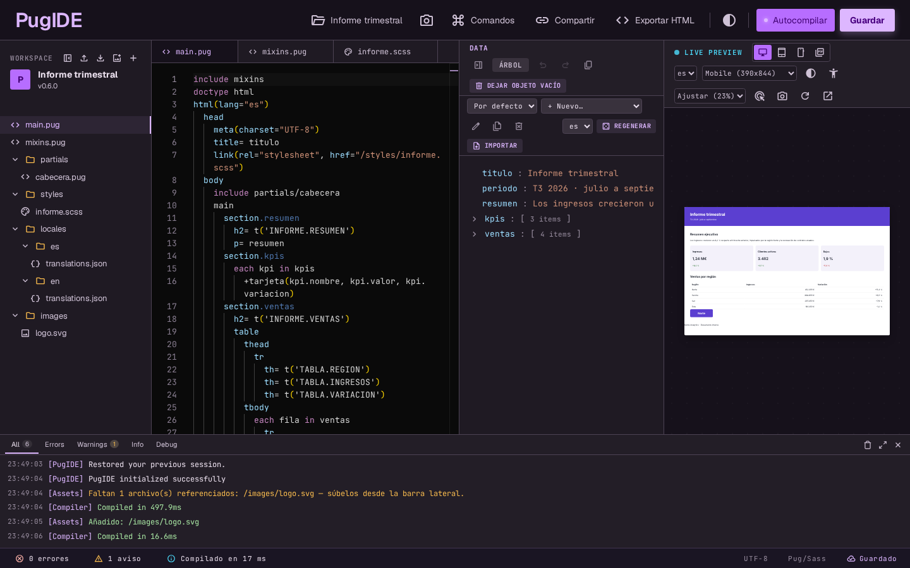
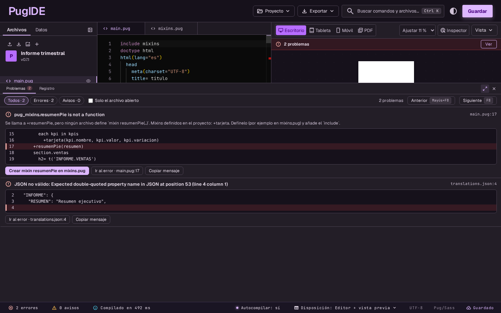
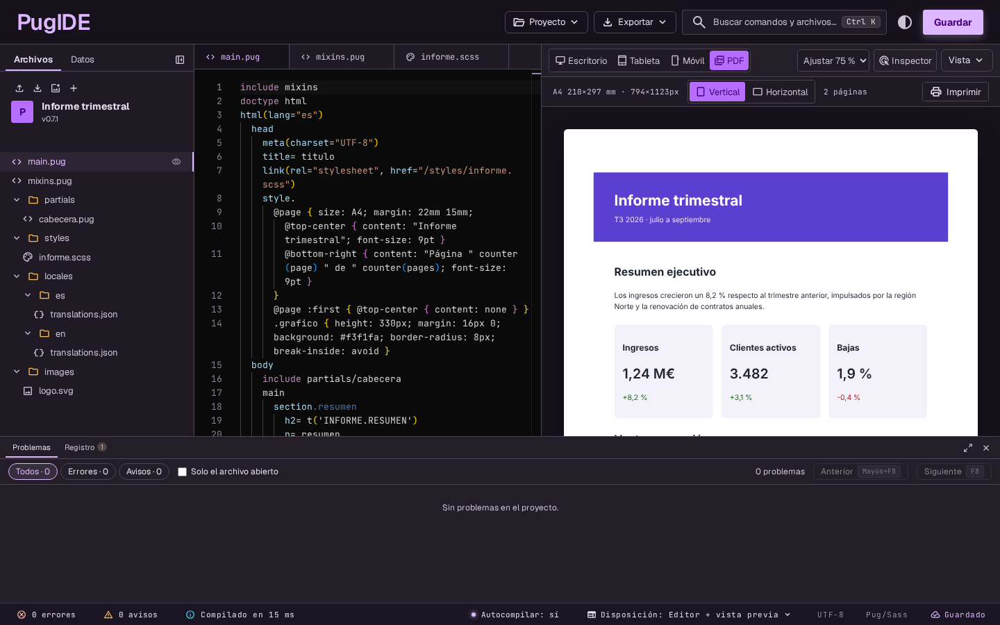
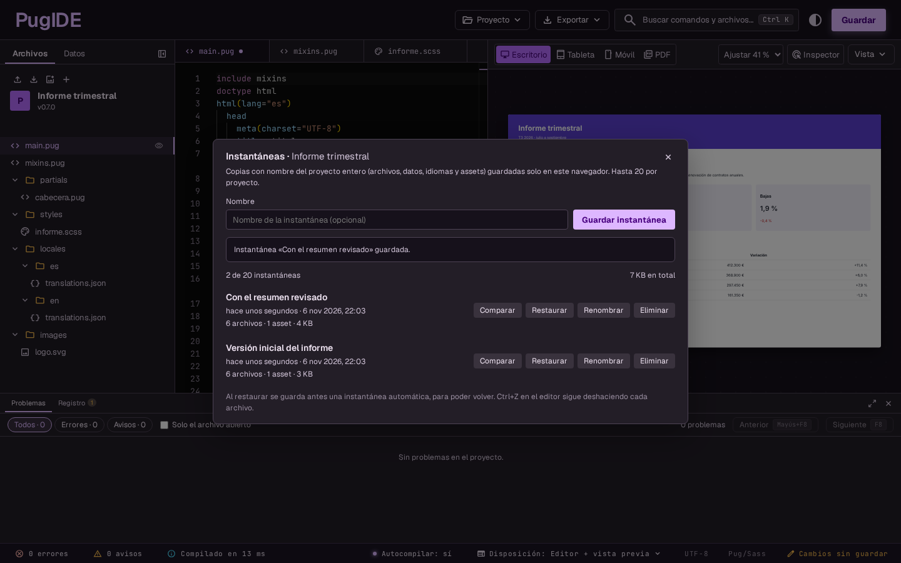
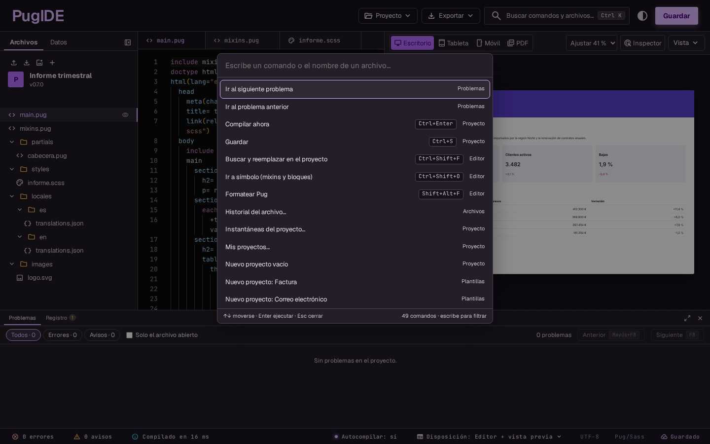
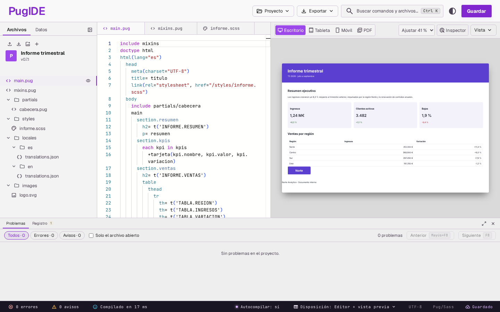

<div align="center">


# PugIDE

**The Pug/Jade IDE that lives in your browser.**<br>
Write a template, see the result instantly, and let PugIDE make up the test data. Nothing leaves your machine.

[Español](README.md) · **English**

[](https://github.com/ElMaxter99/pugIDE/actions/workflows/ci.yml)


<br>



</div>

> The app interface and most of the documentation are in Spanish; this README is the English version of [README.md](README.md).

## What is PugIDE?

A visual development environment for **Pug/Jade**, built for real templates: emails, reports, invoices and pages with several files, styles and translations. It detects the variables your template uses, generates sample data to fill them in, and **repaints the result as you type**. Everything happens in your browser: there is no server, no account, and your code is never uploaded anywhere.

| | |
|---|---|
| 🔒 **100% local** | No backend and no account. Your projects live in your browser and your templates' JavaScript runs isolated. |
| ⚡ **Live preview** | Compiles as you type, as desktop, mobile or a printed page (PDF). |
| 🪄 **Automatic mocks** | Detects variables and `t('KEY')` translation keys and creates sample data you can then edit. |
| 🧩 **Real projects** | Folders, `include`, `extends`, mixins, CSS/SCSS/Sass/Less, images and fonts. |
| 🩺 **Errors you can understand** | Explains what happened, jumps to the line and fixes the usual cases in one click. |
| 📄 **PDF faithful to Chromium** | Page breaks, repeated table headers, orphans and widows. |

## At a glance

### 🩺 Errors explained, with a fix and a link to the line

A Pug error such as `pug_mixins.resumenPie is not a function` becomes: *"`+resumenPie` is called, but no file defines that mixin"*, with a **Go to error** button, the **Problems** panel with all of them, and a one-click fix (**create the mixin**, **add the missing `include`**, correct a typo). It also shows up as a Monaco quick fix (`Ctrl+.`).



### 📄 PDF mode: the printed page, before printing

It reads your `@page` (size, margins, headers and footers with `counter(page)`), lays the content out in sheets the way Chromium would, **repeats the headers of long tables**, honours `orphans`/`widows`, and warns you about anything that would break badly, with the CSS rule that fixes it.



### 📸 Project snapshots

Save the whole project under a name (files, data, languages and assets), **compare** it with what you have now and **restore** it. An automatic copy is saved before restoring, and `Ctrl+Z` keeps working.



### ⌨️ Everything one `Ctrl+K` away

The command palette gathers actions, starter templates, preview devices and quick file opening. It shows your **recent commands** and each one's **shortcut**, and highlights what matches what you type.



### 🌗 Dark and light themes



## Everything it includes

<details open>
<summary><strong>Editor</strong></summary>

- Monaco with Pug highlighting, multi-file support and **autocompletion** of detected variables and mixins (`+` lists mixins with their arguments).
- **Go to definition** of `include` / `extends` / `+mixin` (Ctrl+click or F12), hover with the signature and call count, and "Go to symbol" (Ctrl+Shift+O).
- **Find and replace across the whole project** (Ctrl+Shift+F), with regular expressions.
- **Pug formatter** (Shift+Alt+F): conservative, normalises indentation and attributes; reordering attributes is optional.
- Error markers on the exact file and line (Pug, SCSS/Sass and Less), including included partials.
- Per-file undo, local per-file history (30 versions, with diff) and project **snapshots**.
</details>

<details>
<summary><strong>Data and templates</strong></summary>

- Automatic variable detection and a **tree data editor** with data sets.
- Realistic **mocks**, and import from JSON, JSON Schema or OpenAPI.
- **Translations**: `t('A.B')` keys create editable fields; "Add language…" generates `locales/es-ES/translations.json`, `locales/en/translations.json`… and the preview gets a language selector.
- **Your own helpers**: a `helpers.js` with `module.exports = { money, formatDate… }` makes those functions available in templates.
- `:cdata` and `:markdown` filters, and helper methods on values (`utils.upper(x)`).
- CSS, SCSS/Sass and Less compiled in the browser, with local `<link>`s and `@import`/`@use` between files.
- Local images and fonts (kept in your browser and served to the preview).
</details>

<details>
<summary><strong>Preview</strong></summary>

- Desktop, tablet and mobile, with automatic scaling and a light/dark theme for the document.
- **Choose which template to see:** if you import several loose `.pug` or `.jade` files, "Previsualizar este archivo" (file tree menu or palette) renders the one you pick.
- **Your workspace, your way:** four layouts (`Ctrl+Alt+1…4`), resizable panels with drag handles, and data as a tab of the side panel; they are remembered in your preferences.
- **PDF mode** with `@page`, headers and footers, break warnings, printing and saving as PDF.
- **PNG capture** of the preview, element inspector and accessibility audit.
- **Page navigator** in PDF mode: previous, next, go to page, and a panel with one tile per sheet.
- Links between templates (`href="invoice.pug"`) preview that template.
- Quality hints: unused data, HTML weight (e.g. Gmail's 102 KB limit).
</details>

<details>
<summary><strong>Projects</strong></summary>

- **Guided first run:** a welcome with one-click starter templates (report, invoice, email, empty) and a 4-step tour, only the first time.
- A project library in your browser: open, create from a template, rename, duplicate and delete.
- **Import** a folder or a `.zip` (also by **dragging** them onto the file tree) and **export** to a folder, a `.zip` or a self-contained HTML file.
- **Export for email**: inlined CSS, no scripts, weight against Gmail's limit, and compatibility warnings (Outlook, web fonts, images without `alt`).
- **Export every template** in a project to a `.zip` of `.html` files.
- **Your own templates**: save a project as a starting point and reuse it; export and import them as `.zip`.
- Share by link, and a backup reminder.
- The app **updates itself**: it tells you about new versions so you never have to clear your cache.
</details>

## Privacy and security

- **Nothing leaves your browser.** There is no backend, no account and no code upload. The editor, fonts and icons are served from the site itself, with no CDNs.
- **Your data lives in your browser** (`localStorage` and IndexedDB). If you clear the site's data you lose it: export your projects. The Log reminds you after 14 days.
- **Your templates' JavaScript is isolated.** What you write in a template, in `helpers.js` or in a `<script>` of the HTML it generates runs in opaque-origin documents, with no access to your projects or to the rest of the page, and with the network blocked by the Content Security Policy (CSP). The app itself allows neither `unsafe-inline` nor `unsafe-eval` in `script-src`.
- **Optional analytics.** On entry you are asked whether to allow anonymous visit analytics ([Vercel Web Analytics](https://vercel.com/docs/analytics), no tracking cookies and no data from your projects). If you decline, the script is never loaded; you can change your mind under Ctrl+K → "Privacidad".

## How it works

```
parser  →  data  →  orchestrator  →  compiler  →  preview
 Pug       mocks     one single flow   Pug in a     opaque-origin
 & templates         with debounce     Worker       iframe
```

Angular 22 (standalone components, signals), Monaco, the Pug compiler bundled for the browser, `sass` and `less` on the client, and Angular's service worker for offline use. The details are in [docs/ARCHITECTURE.md](docs/ARCHITECTURE.md) (in Spanish).

## Install

PugIDE runs in the browser, as a **PWA** (its own icon and window, nothing to download) and as a **desktop app** for **Windows, macOS and Linux**, offline. The desktop installers are free and **unsigned** (no paid certificates): open-source MIT software, no warranty, use at your own responsibility. Steps and warnings in **[docs/INSTALAR.md](docs/INSTALAR.md)** (Spanish); installers are on the [releases](https://github.com/ElMaxter99/pugIDE/releases) page.

## Getting started

You need Node.js and npm.

```bash
git clone https://github.com/ElMaxter99/pugIDE.git
cd pugIDE
npm install
npm start          # http://localhost:4200
```

Open <http://localhost:4200/ide?demo=true> to load a complete sample project.

| Command | What for |
|---|---|
| `npm start` | Development server |
| `npm run build:prod` | Production build (also checks that the engine bundles are up to date) |
| `npm run lint` | ESLint |
| `npm run test:unit` | Unit tests for the pure utilities |
| `npm run test:e2e` | End-to-end tests of the services, with the real render in Node |
| `npm run test:ui` | Playwright UI tests against the build (`PUGIDE_BROWSER=firefox` or `webkit` for the other browsers) |
| `npm run perf` | Performance measurements of pagination and the preview |
| `npm run screenshots` | Regenerates this README's screenshots |
| `npm run release:check` | Checks that the version is consistent before tagging |

## Handy shortcuts

| Shortcut | Action |
|---|---|
| `Ctrl/Cmd + K` | Command palette |
| `Ctrl/Cmd + Enter` | Compile now |
| `Ctrl/Cmd + S` | Save |
| `Ctrl/Cmd + Shift + F` | Find and replace in the project |
| `Ctrl + Alt + 1…4` | Switch layout (on AltGr keyboards, use the "Disposición" menu) |
| `Ctrl/Cmd + B` · `Ctrl/Cmd + J` | Show or hide the side panel · the bottom panel |
| `F8` · `Shift + F8` | Next · previous problem |
| `Ctrl/Cmd + .` | Quick fix for the problem under the cursor |
| `F12` · `Ctrl/Cmd + click` | Go to definition |
| `Shift + Alt + F` | Format the file |
| `Ctrl + M` (`Ctrl + Shift + M` on Mac) | Release editor focus with Tab |

The full list is in the palette → "Atajos de teclado" (Keyboard shortcuts). On a Mac, `Ctrl` means `Cmd` except where noted.

## Known limitations

- Your projects only exist in this browser: there is no sync between devices and no collaboration.
- PugIDE is designed for the desktop: it has not been designed or tested for mobile.
- The PDF preview **emulates** Chromium's pagination; the final result may vary by browser when printing. Chromium does not print `string()`, `string-set`, `element()` or `running()`, so PugIDE does not emulate them: it warns instead.
- Pug filters that need Node packages (`:scss`, `:stylus`…) do not exist in the browser; `:markdown` is a subset.
- PNG capture does not run the page's JavaScript.
- Importing and exporting to a folder uses the File System Access API (Chrome/Edge); Firefox and Safari use `.zip`.

## Documentation and roadmap

These documents are in Spanish.

- [docs/ARCHITECTURE.md](docs/ARCHITECTURE.md): architecture, isolation, CSP, PDF and measured performance.
- [docs/PLAN.md](docs/PLAN.md): project status and next steps.
- [docs/INSTALAR.md](docs/INSTALAR.md): installing PugIDE as a PWA or a desktop app.
- [docs/ESCRITORIO.md](docs/ESCRITORIO.md): how and why the desktop app was built, and what is missing.
- [docs/RELEASE.md](docs/RELEASE.md): how a version is released and deployed.
- [CHANGELOG.md](CHANGELOG.md): what changes in each version.
- [design/README.md](design/README.md): the design canvas ("design first") and the tokens in [docs/brand/DESIGN_TOKENS.md](docs/brand/DESIGN_TOKENS.md).

## Contributing

Contributions are welcome: read [CONTRIBUTING.md](CONTRIBUTING.md) and [CLAUDE.md](CLAUDE.md). All interface text, commits and documentation are written in Spanish (this README also has an English version, kept in sync with the Spanish one); code identifiers are in English.

## License

Released under the [MIT](LICENSE) license. It is **free to use**, but you must **keep the copyright notice and credit the original author**:

> PugIDE © 2026 [ElMaxter99](https://github.com/ElMaxter99) — <https://github.com/ElMaxter99/pugIDE>
