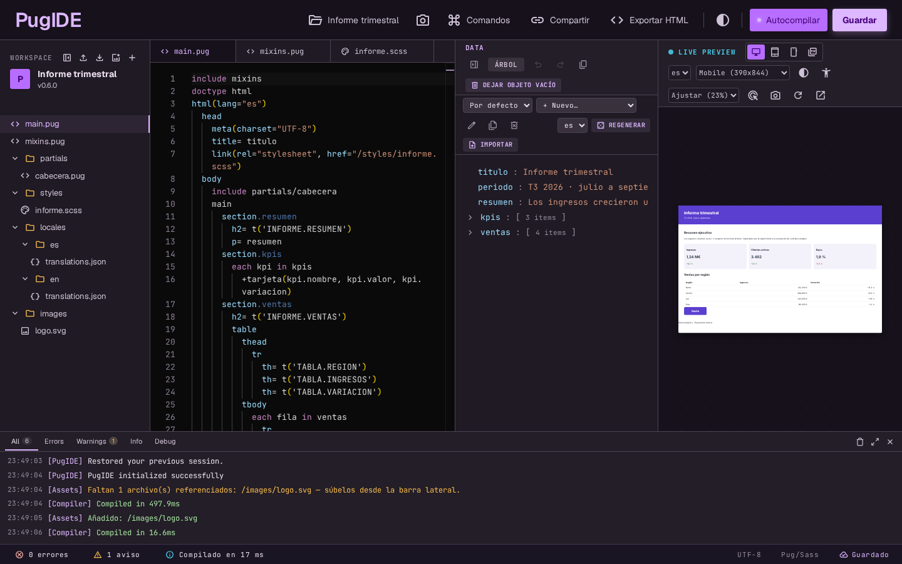
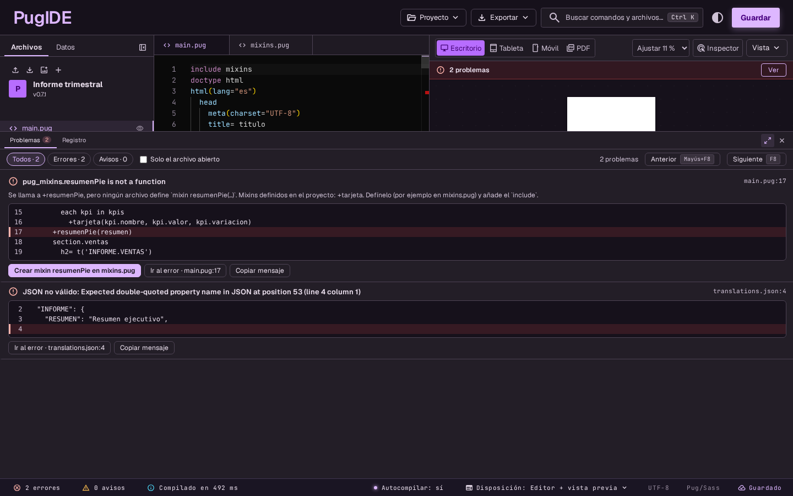
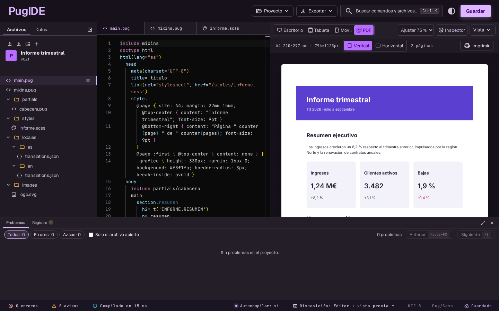
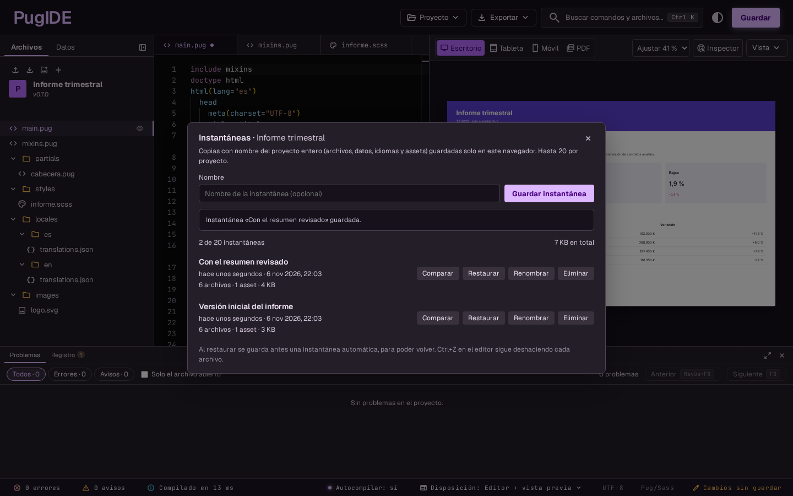
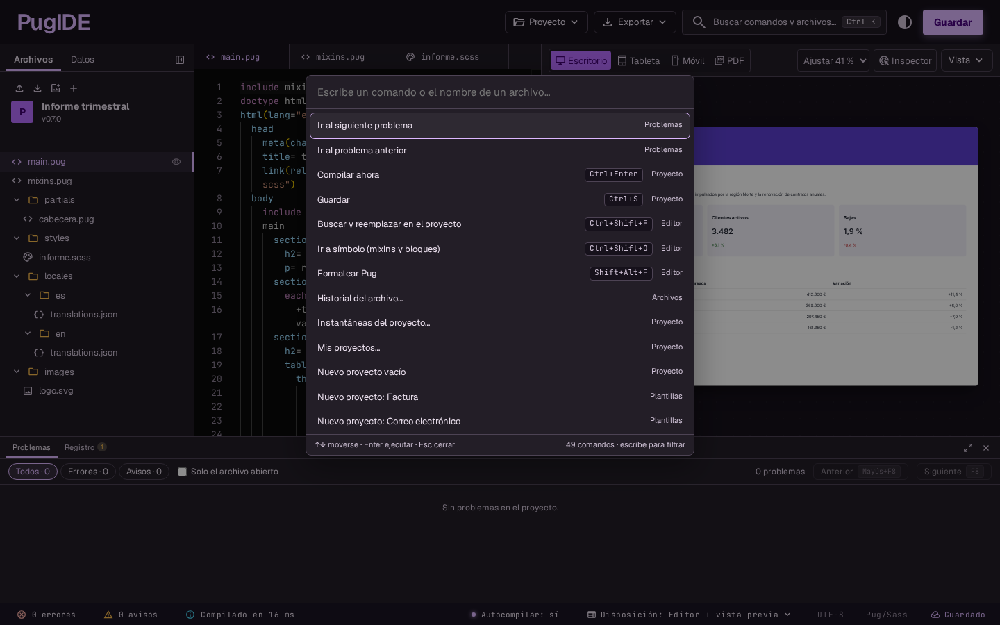
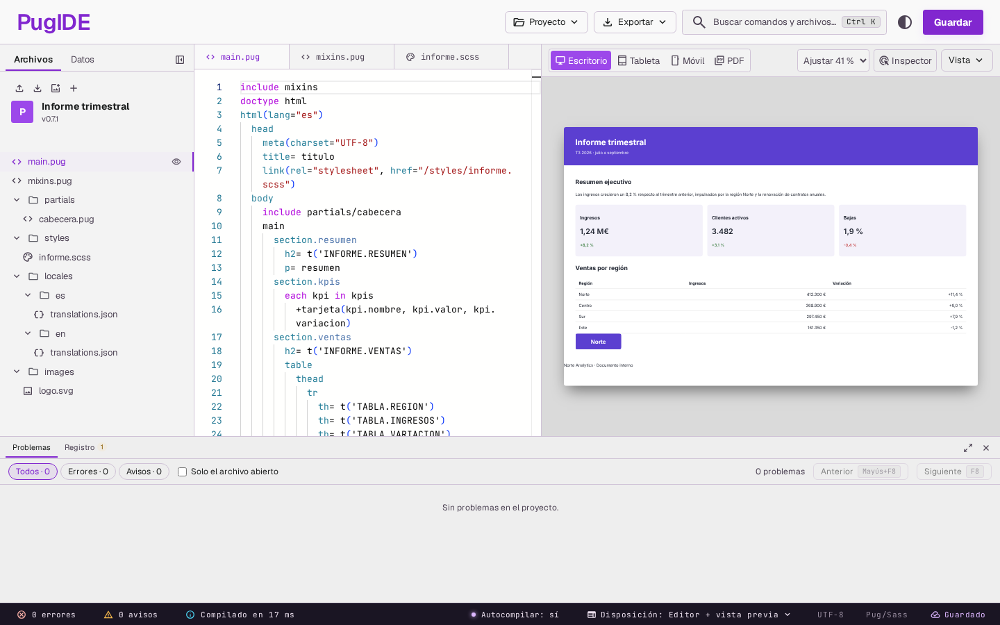

<div align="center">


# PugIDE

**El IDE de Pug/Jade que vive en tu navegador.**<br>
Escribe una plantilla, mira el resultado al instante y deja que PugIDE invente los datos de prueba. Nada sale de tu máquina.

**Español** · [English](README.en.md)

[](https://github.com/ElMaxter99/pugIDE/actions/workflows/ci.yml)


<br>



</div>

## ¿Qué es PugIDE?

Un entorno de desarrollo visual para **Pug/Jade** pensado para plantillas reales: correos, informes, facturas y páginas con varios archivos, estilos y traducciones. Detecta las variables que usa tu plantilla, genera datos de ejemplo para rellenarlas y **repinta el resultado mientras escribes**. Todo ocurre en tu navegador: no hay servidor, no hay cuenta y tu código nunca se sube a ningún sitio.

| | |
|---|---|
| 🔒 **100 % local** | Sin backend ni cuenta. Tus proyectos viven en tu navegador y el JavaScript de tus plantillas corre aislado. |
| ⚡ **Preview en vivo** | Compila al escribir, en escritorio, móvil o como página impresa (PDF). |
| 🪄 **Mocks automáticos** | Detecta variables y claves `t('CLAVE')` y crea datos de ejemplo que luego editas. |
| 🧩 **Proyectos reales** | Carpetas, `include`, `extends`, mixins, CSS/SCSS/Sass/Less, imágenes y fuentes. |
| 🩺 **Errores que se entienden** | Explica qué pasa, te lleva a la línea y arregla lo típico con un clic. |
| 📄 **PDF fiel a Chromium** | Saltos de página, cabeceras de tabla repetidas, huérfanas y viudas. |

## Un vistazo

### 🩺 Errores explicados, con arreglo y enlace a la línea

Un error de Pug como `pug_mixins.resumenPie is not a function` pasa a ser: *«Se llama a `+resumenPie`, pero ningún archivo define ese mixin»*, con el botón **Ir al error**, el panel **Problemas** con todos los del proyecto y el arreglo con un clic (**Crear el mixin**, **añadir el `include`**, corregir una errata). También como arreglo rápido de Monaco (`Ctrl+.`).



### 📄 Modo PDF: la página impresa, antes de imprimir

Lee tu `@page` (tamaño, márgenes, cabeceras y pies con `counter(page)`), reparte el contenido en hojas como lo haría Chromium, **repite las cabeceras de las tablas largas**, respeta `orphans`/`widows` y te avisa de lo que se partiría mal, con la regla CSS que lo arregla.



### 📸 Instantáneas del proyecto

Guarda el proyecto entero con nombre (archivos, datos, idiomas y assets), **compara** con lo que tienes ahora y **restaura**. Antes de restaurar se guarda una copia automática, y `Ctrl+Z` sigue funcionando.



### ⌨️ Todo a un `Ctrl+K`

La paleta de comandos reúne las acciones, las plantillas de inicio, los dispositivos del preview y la apertura rápida de archivos. Enseña tus **comandos recientes** y el **atajo** de cada uno, y resalta lo que coincide con lo que escribes.



### 🌗 Tema oscuro y claro



## Todo lo que incluye

<details open>
<summary><strong>Editor</strong></summary>

- Monaco con resaltado de Pug, soporte multiarchivo y **autocompletado** de variables detectadas y de mixins (`+` lista los mixins con sus argumentos).
- **Ir a la definición** de `include` / `extends` / `+mixin` (Ctrl+clic o F12), hover con la firma y el número de llamadas, y «Ir a símbolo» (Ctrl+Mayús+O).
- **Buscar y reemplazar en todo el proyecto** (Ctrl+Mayús+F), con expresiones regulares.
- **Formateador de Pug** (Mayús+Alt+F): conservador, normaliza indentación y atributos; reordenar atributos es opcional.
- Marcadores de error en el archivo y la línea exactos (Pug, SCSS/Sass y Less), también en parciales incluidos.
- Deshacer de archivos, historial local por archivo (30 versiones, con diff) y **instantáneas** de proyecto.
</details>

<details>
<summary><strong>Datos y plantillas</strong></summary>

- Detección automática de variables y **editor de datos en árbol** con juegos de datos.
- **Mocks** realistas, importación desde JSON, JSON Schema u OpenAPI.
- **Traducciones**: las claves `t('A.B')` crean campos editables; con «Añadir idioma…» se generan `locales/es-ES/translations.json`, `locales/en/translations.json`… y el preview tiene un selector de idioma.
- **Helpers propios**: un `helpers.js` con `module.exports = { money, formatDate… }` hace esas funciones disponibles en las plantillas.
- Filtros `:cdata` y `:markdown`, y métodos de helpers sobre valores (`utils.upper(x)`).
- Estilos CSS, SCSS/Sass y Less compilados en el navegador, con `<link>` locales y `@import`/`@use` entre archivos.
- Imágenes y fuentes locales (se guardan en tu navegador y se sirven al preview).
</details>

<details>
<summary><strong>Preview</strong></summary>

- Escritorio, tablet y móvil, con escala automática y tema claro/oscuro del documento.
- **Elige qué plantilla ver:** si importas varios `.pug` o `.jade` sueltos, «Previsualizar este archivo» (menú del árbol o paleta) renderiza el que quieras.
- **Tu espacio, a tu medida:** cuatro disposiciones (`Ctrl+Alt+1…4`), paneles redimensionables con tiradores y los datos como pestaña del panel lateral; se recuerdan en tus preferencias.
- **Modo PDF** con `@page`, cabeceras y pies, avisos de corte, impresión y guardado como PDF.
- **Captura PNG** del preview, inspector de elementos y auditoría de accesibilidad.
- **Navegador de páginas** en el modo PDF: anterior, siguiente, ir a la página y un panel con una ficha por hoja.
- Los enlaces entre plantillas (`href="factura.pug"`) previsualizan esa plantilla.
- Avisos de calidad: datos sin usar, peso del HTML (p. ej. el límite de 102 KB de Gmail).
</details>

<details>
<summary><strong>Proyectos</strong></summary>

- **Primer uso guiado:** una bienvenida con plantillas de un clic (Informe, Factura, Correo, vacío) y un recorrido de 4 pasos, solo la primera vez.
- Biblioteca de proyectos en tu navegador: abrir, crear desde plantilla, renombrar, duplicar y borrar.
- **Importar archivos** al proyecto abierto: archivos sueltos o una carpeta entera (también **arrastrándolos** al árbol), eligiendo la carpeta de destino y viendo antes qué es nuevo y qué ya existe. **Importar proyecto** (carpeta o `.zip`) desde «Mis proyectos» crea uno nuevo sin tocar el abierto. **Exportar** a carpeta, `.zip` o HTML autocontenido.
- **Exportar para correo**: CSS en línea, sin scripts, peso contra el límite de Gmail y avisos de compatibilidad (Outlook, fuentes web, imágenes sin `alt`).
- **Exportar todas las plantillas** de un proyecto a un `.zip` de `.html`.
- **Plantillas propias**: guarda un proyecto como punto de partida y reutilízalo; se exportan e importan como `.zip`.
- Compartir por enlace y recordatorio de copia de seguridad.
- La app **se actualiza sola**: te avisa de las versiones nuevas sin que tengas que borrar la caché.
</details>

## Privacidad y seguridad

- **Nada sale de tu navegador.** No hay backend, ni cuenta, ni subida de código. El editor, las tipografías y los iconos se sirven desde el propio sitio, sin CDNs.
- **Tus datos viven en tu navegador** (`localStorage` e IndexedDB). Si borras los datos del sitio, los pierdes: exporta tus proyectos. El Registro te lo recuerda a los 14 días.
- **El JavaScript de tus plantillas está aislado.** Lo que escribes en una plantilla, en `helpers.js` o en un `<script>` del HTML que genera corre en documentos de origen opaco, sin acceso a tus proyectos ni al resto de la página, y con la red bloqueada por la política de seguridad (CSP). La propia app no admite `unsafe-inline` ni `unsafe-eval` en `script-src`.
- **Analítica opcional.** Al entrar se te pregunta si permites una analítica anónima de visitas ([Vercel Web Analytics](https://vercel.com/docs/analytics), sin cookies de seguimiento y sin ningún dato de tus proyectos). Si rechazas, el script no se carga nunca; puedes cambiarlo en Ctrl+K → «Privacidad».

## Cómo funciona

```
parser  →  datos  →  orquestador  →  compilador  →  preview
 Pug       mocks     un único flujo     Pug en un      iframe de
 y plantillas        con debounce       Worker         origen opaco
```

Angular 22 (componentes standalone, signals), Monaco, el compilador de Pug empaquetado para el navegador, `sass` y `less` en el cliente, y el service worker de Angular para el uso sin conexión. El detalle está en [docs/ARCHITECTURE.md](docs/ARCHITECTURE.md).

## Instalar

En la app de escritorio, cada cliente puede ser un **espacio de trabajo**: una carpeta de tu equipo que PugIDE abre y guarda como archivos normales. PugIDE funciona en el navegador, como **PWA** (un icono y una ventana propia, sin descargar nada) y como **aplicación de escritorio** para **Windows, macOS y Linux**, sin conexión. Los instaladores de escritorio son gratuitos y **no están firmados** (sin certificados de pago): software libre MIT, sin garantía y bajo la responsabilidad de cada persona. Pasos y avisos en **[docs/INSTALAR.md](docs/INSTALAR.md)**; instaladores en las [releases](https://github.com/ElMaxter99/pugIDE/releases).

## Empezar

Necesitas Node.js y npm.

```bash
git clone https://github.com/ElMaxter99/pugIDE.git
cd pugIDE
npm install
npm start          # http://localhost:4200
```

Abre <http://localhost:4200/ide?demo=true> para cargar un proyecto de ejemplo completo.

| Comando | Para qué |
|---|---|
| `npm start` | Servidor de desarrollo |
| `npm run build:prod` | Build de producción (comprueba también que los bundles del motor están al día) |
| `npm run lint` | ESLint |
| `npm run test:unit` | Pruebas unitarias de las utilidades puras |
| `npm run test:e2e` | Pruebas e2e de los servicios, con el render real en Node |
| `npm run test:ui` | Pruebas de interfaz con Playwright sobre el build (`PUGIDE_BROWSER=firefox` o `webkit` para los otros navegadores) |
| `npm run perf` | Mediciones de rendimiento del paginado y del preview |
| `npm run screenshots` | Regenera las capturas de este README |
| `npm run start:desktop` (o `desktop:start`) | Abre la app de escritorio (Electron) desde el código fuente |
| `npm run test:desktop` (o `desktop:test`) | Prueba de humo de la app de escritorio |
| `npm run release:check` | Comprueba que la versión es coherente antes de etiquetar |

## Atajos útiles

| Atajo | Acción |
|---|---|
| `Ctrl/Cmd + K` | Paleta de comandos |
| `Ctrl/Cmd + Enter` | Compilar ahora |
| `Ctrl/Cmd + S` | Guardar |
| `Ctrl/Cmd + Mayús + F` | Buscar y reemplazar en el proyecto |
| `Ctrl + Alt + 1…4` | Cambiar de disposición (en teclados con AltGr, desde el menú «Disposición») |
| `Ctrl/Cmd + B` · `Ctrl/Cmd + J` | Mostrar u ocultar el panel lateral · el panel inferior |
| `F8` · `Mayús + F8` | Siguiente · anterior problema |
| `Ctrl/Cmd + .` | Arreglo rápido del problema bajo el cursor |
| `F12` · `Ctrl/Cmd + clic` | Ir a la definición |
| `Mayús + Alt + F` | Formatear el archivo |
| `Ctrl + M` (`Ctrl + Mayús + M` en Mac) | Soltar el foco del editor con Tab |

La lista completa está en la paleta → «Atajos de teclado». En Mac, `Ctrl` equivale a `Cmd` salvo donde se indica.

## Limitaciones conocidas

- Tus proyectos solo existen en este navegador: no hay sincronización entre dispositivos ni colaboración.
- PugIDE está pensado para el escritorio: no se ha diseñado ni probado para móvil.
- El preview PDF **emula** la paginación de Chromium; el resultado final puede variar según el navegador al imprimir. `string()`, `string-set`, `element()` y `running()` no los imprime Chromium, así que PugIDE no los emula: avisa.
- Los filtros de Pug que necesitan paquetes de Node (`:scss`, `:stylus`…) no existen en el navegador; `:markdown` es un subconjunto.
- La captura PNG no ejecuta el JavaScript de la página.
- Exportar a una carpeta usa la File System Access API (Chrome/Edge); en Firefox y Safari se exporta como `.zip`. Importar carpetas funciona en todos.

## Documentación y hoja de ruta

- [docs/ARCHITECTURE.md](docs/ARCHITECTURE.md): arquitectura, aislamiento, CSP, PDF y rendimiento medido.
- [docs/PLAN.md](docs/PLAN.md): estado del proyecto y siguientes pasos.
- [docs/INSTALAR.md](docs/INSTALAR.md): instalar PugIDE como PWA o como aplicación de escritorio.
- [docs/ESCRITORIO.md](docs/ESCRITORIO.md): cómo y por qué se hizo la app de escritorio, y lo que falta.
- [docs/RELEASE.md](docs/RELEASE.md): cómo se publica una versión y se despliega.
- [CHANGELOG.md](CHANGELOG.md): qué cambia en cada versión.
- [design/README.md](design/README.md): el lienzo de diseño («diseño primero») y los tokens de [docs/brand/DESIGN_TOKENS.md](docs/brand/DESIGN_TOKENS.md).

## Contribuir

Las contribuciones son bienvenidas: lee [CONTRIBUTING.md](CONTRIBUTING.md) y [CLAUDE.md](CLAUDE.md). Todo el texto de la interfaz, los commits y la documentación va en español (este README tiene además una [versión en inglés](README.en.md), que se actualiza junto con él); los identificadores del código, en inglés.

## Licencia

Distribuido bajo licencia [MIT](LICENSE). Es de uso **libre y gratuito**, pero debes **mantener el aviso de copyright y mencionar al autor original**:

> PugIDE © 2026 [ElMaxter99](https://github.com/ElMaxter99) — <https://github.com/ElMaxter99/pugIDE>
